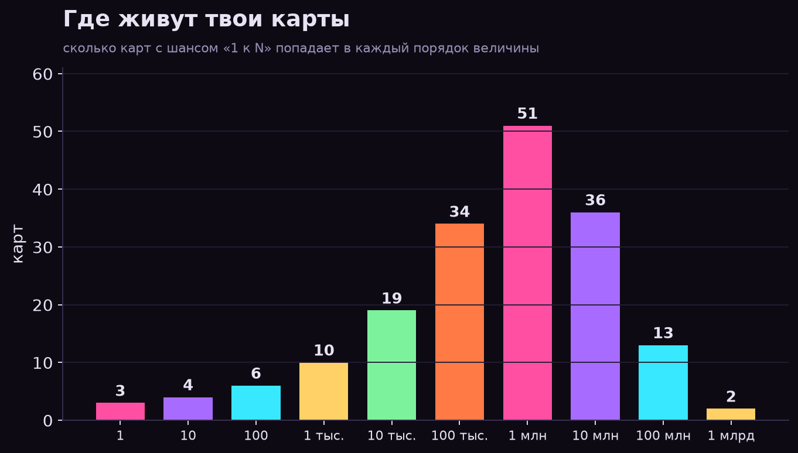
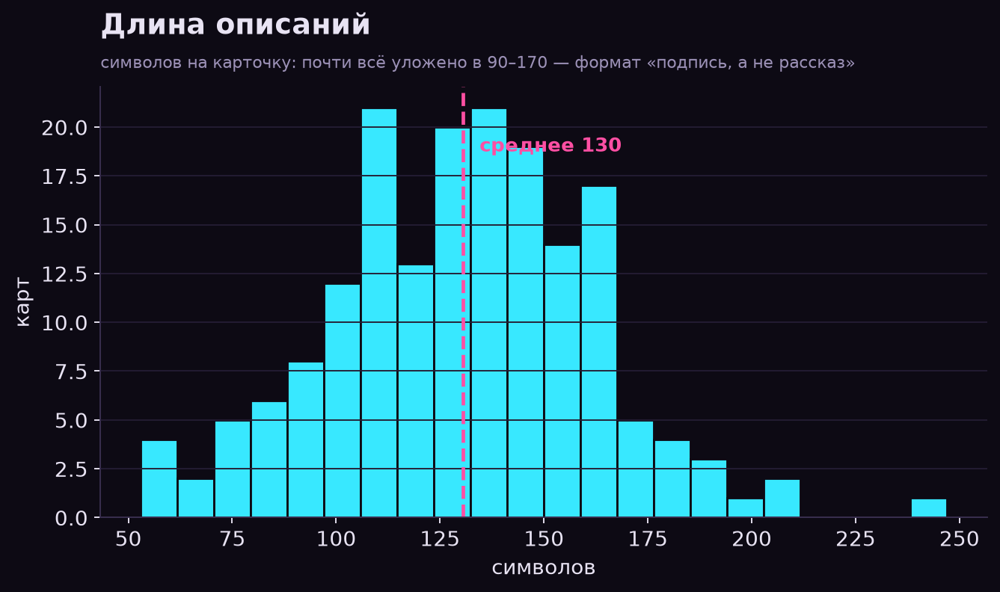
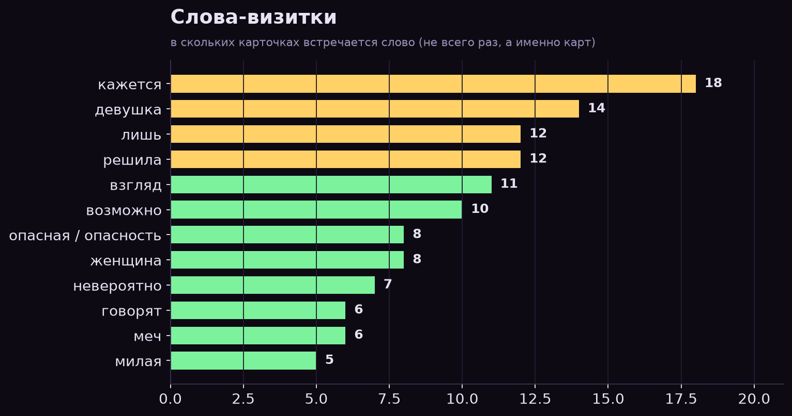
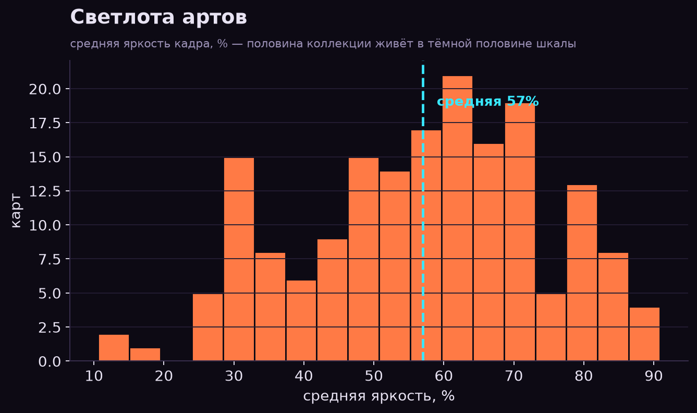
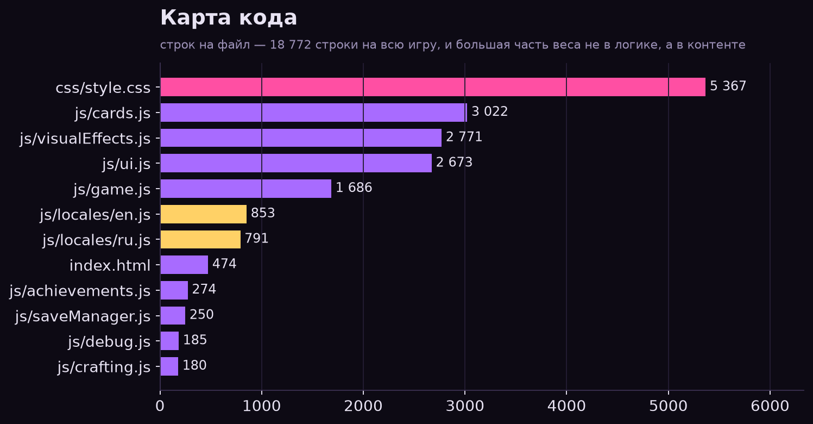

# Досье автора — Gal's RNG 0.2.16

Статистика не про игру, а про её автора. Считано из репозитория: `js/cards.js` (178 редкостей),
`js/locales/*` (956 ключей × 2 языка), `js/achievements.js`, `js/crafting.js`, `js/events.js`,
CSS, `CHANGELOG.md` и 178 артов в `img/webp/`.

Красивая версия с графиками: **[AUTHOR-STATS.html](AUTHOR-STATS.html)** (самодостаточный файл,
графики вшиты). Скрипты: `tools/author-stats/`.

---

## 01. Соотношения

| Что к чему | Пропорция | Комментарий |
|---|---|---|
| альты ↔ базовые карты | **46 : 132** | каждый четвёртый арт — вариация знакомой героини; 39 семей, 93 карты-одиночки |
| база ↔ лимитки | **146 : 32** = 4,6 : 1 | внутри ивентов ровно: Хэллоуин 24 : Шоколад 8 = 3 : 1 |
| маньячки ↔ горничные | **20 : 3** = 6,7 : 1 | на Эллен, студентку и С.А.К.У.Я. — двадцать карт с ножом и бензопилой |
| ушки и хвосты ↔ горничные | **17 : 3** = 5,7 : 1 | кемномими и эльфы водятся чаще прислуги |
| с престижем ↔ без | **96 : 82** | три карты заперты до 6-го перерождения: Гал, Догма, Тето |
| русские ↔ английские комментарии | **507 : 40** = 12,7 : 1 | TODO/FIXME — ноль, планы живут в русских заметках |
| многоточие ↔ восклицание | **63 : 27** = 2,3 : 1 | интонация «…», а не «!»; ещё 12 карт шутят ремаркой в скобках |
| славянское ↔ античное | **7 : 5** | Медведева в трёх лицах + Лешиха, Домовушка, Яга, Царевна-Лягушка |
| экипировка ↔ остальной магазин | **21 : 12** | 33 позиции: 21 предмет, 7 бустов, 5 апгрейдов |
| «кажется» ↔ «точно» | **18 : 0** | слово-визитка №1, встречается в 18 карточках |

## 02. Математика редкости

- Медиана — **1 к 1,6 млн**. Всего 3 карты «мусорного дна»: 1/1, 1/4, 1/8.
- **102** карты реже 1/1 000 000, **51** — реже 1/10 млн, **15** — реже 1/100 млн, **1** — реже миллиарда (Догма, 1/1 010 101 010).
- Сумма всех шансов — **159%** (ролл идёт независимыми проверками от редкого к частому).
- Только **29** чисел идеально круглые; **12** подогнаны под персонажа (1/10 000 002, 1/50 000 441, 1/2 000 333, 1/702 001).
- **10** репдиджитов: 666, 777, 66 666, 6 666 666, 7 777 777, 9 999 999, 77 777 777, 1 010 101 010.
- Мем-номера: `404403`, `9876543`, `401040104`, `1999`/`199900`, `0023`, `3741`.

## 03. Интонация

- 23 232 символа описаний: **130 символов / 20 слов** в среднем, медиана 132.
- **45 карт (25%)** обращаются к игроку на «ты» — всего 59 обращений.
- Словарь — **1 695** уникальных слов, из них **1 449 (85%)** встречаются ровно один раз.
- Самое длинное описание — Амелия (247 символов), самое короткое — Мусорный идол (53).
- **63** карты с «…», **27** с «!», **12** с ремаркой в скобках, **5** с «~», **21** CAPS-слово.
- 8 английских вставок на всю коллекцию: `EDITO! EGALE!`, `CUMALITY`, `TUCA DONKA!`, `GYATT`.
- 6 карт с пропущенным пробелом после точки («страну!Просто», «километр.Но») — фирменный след.

## 04. Что любит автор

Ручная разметка 178 карт: **55 карт (31%)** — отсылка к чужой вселенной.

| Источник | Карт |
|---|---|
| Славянский фольклор | 7 |
| Античная мифология | 5 |
| Хоррор-кино и крипипаста (Звонок, Слендер, Джефф, Крик) | 4 |
| Четыре всадника Апокалипсиса | 4 |
| Bleach | 3 |
| Berserk · JJK · JoJo · Undertale · DMC · Chainsaw Man · Tokyo Revengers | по 2 |
| Genshin · Touhou · Naruto · Dragon Ball · Hollow Knight · Elden Ring · Hazbin Hotel · Hellsing · Mortal Kombat · Vocaloid | по 1 |

Архетипы: маньячки и монстры **20**, ушки и хвосты **17**, боевые девы **17**, химия и материалы **17**,
богини **11**, умершие и нежить **9**, тёти-мамочки **6**, горничные **3**.

- Самая эксплуатируемая героиня — **Ева**: обычная, «Ризз Ева» и «Ева в шоколаде». По три карты также у Медведевой и Ткачихи.
- Хэллоуин — **24 карты (13,5% коллекции)**: не ивент, а второй основной пул.
- Систем на контенте плотно: **43** визуальных эффекта (24% карт с собственной анимацией), 12 тем, 23 достижения, 5 коллекций, 20 материалов, 15 рецептов, 8 объявленных ивентов (лимитки — у двух).

## 05. Цвет и арт

- 178 артов, **41 МБ** WebP; 145 штук в 1024×1360, остальные — ещё в шести разрешениях.
- Средняя яркость кадра **57%**, у 22% карт больше пятой части картинки — тёмные пиксели.
- Самые тёмные: Сущность (10,6%), Безглазая Джекки (13,6%), Пугало (18,8%). Самые светлые: Радость (90,9%), Лисья морда (88,5%), Тина (87,1%).

## 06. Код

- **18 772** строки: CSS 5 367 > cards.js 3 022 > visualEffects 2 771 > ui 2 673 > game 1 686.
  Оформление и контент весят больше механики.
- **507** русских комментариев против **40** английских (92,7%); `Math.random` — 171 раз, `gsap` — 151, `console.log` — 51, слово *luck* — **277** раз.
- Локализация: 956 ключей, 39 064 символа RU против 39 066 EN — паритет.
- `CHANGELOG.md`: 9 версий, 214 пунктов, 3 413 слов.
- Два симулятора баланса в `tools/` — баланс считался скриптами.

## 07. Про Биг Буб и Смолл Буб

В данных нет ни одного поля про фигуру — «6 к 1» это чей-то пересчёт артов глазами, а не статистика
по репозиторию. По **текстам** шутки про размер есть, и в обе стороны: «маленький секретик ;)... а может
и не маленький» (Алекс), «пара «небольших» деталей» (Орочи) — против «две больших пасхальных радости»
(Пасхальный кролик), «два очень весомых аргумента» (Ризз Ева), «большие... таланты» (Женя).

Настоящие «6 к 1» в проекте: маньячки к горничным (6,7 : 1), ушки к горничным (5,7 : 1),
русские комментарии к английским (12,7 : 1).

## 08. Если совсем коротко

1. Автор контента, а не механик: данные тяжелее движка, CSS больше логики, треть карт — цитаты.
2. Пишет как стендап-подпись: 130 символов, «кажется», многоточие, ремарка в скобках; 85% слов использованы один раз.
3. Верит в числа как в шутку: 1/666, 1/777, 1/1010101010, 1/702001.
4. Прячет половину игры за престижем и строит билд, а не гачу.
5. Очень любит Хэллоуин — 13,5% карт и второй круг ивента в 2026-м.
